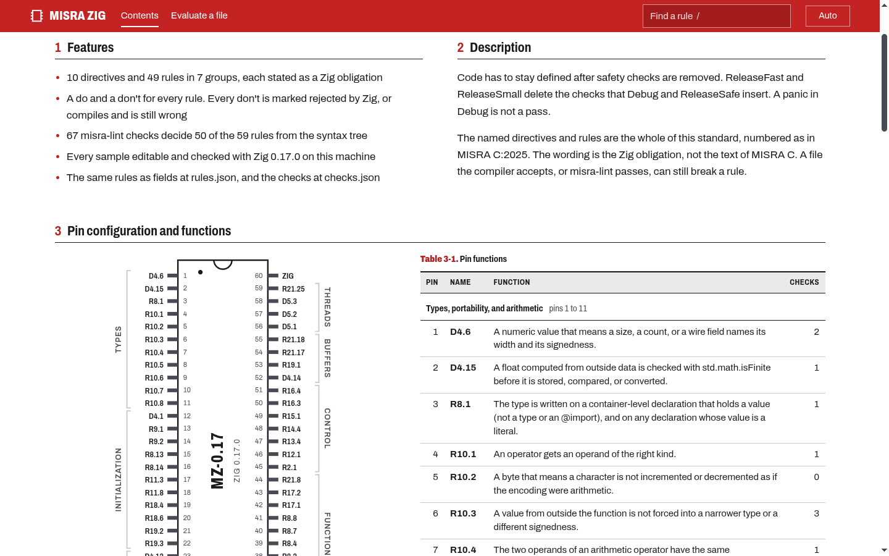

# MISRA Zig

A coding standard for Zig 0.17, inspired by MISRA C, for people who write Zig
that has to stay defined in ReleaseFast. Each rule has a do and a don't, with
machine checks where syntax alone can identify a breach.

Debug and ReleaseSafe insert safety checks. ReleaseFast and ReleaseSmall delete
them, so an overflowing `+`, out-of-bounds index, or out-of-range `@intCast`
becomes illegal behavior. A panic in Debug is not a pass. This standard
names what has to hold without those checks, illustrates the rules with source
examples, and ships `misra-lint`, a checker built on the Zig parser that flags
what a syntax tree can decide.



## Run it

The local server requires Linux, Zig 0.17.0, Bun, and `prlimit` (from
util-linux) on `PATH`. It uses `prlimit` to cap compiler memory and refuses
to start without it.

```bash
bun scripts/server.ts
```

Set `ZIG` to the compiler path if Zig 0.17.0 is not your default
(e.g. `ZIG="/path/to/zig-0.17.0/zig" bun scripts/server.ts`).

Open `http://127.0.0.1:4173`. The handbook is set as a component datasheet: the
pin map on the front sheet has one pin per rule, and each rule sheet has its
description, the do and the don't as figures, and the checks that decide it.
Any sample can be edited and checked; "Evaluate a file" checks a whole file
with the compiler and misra-lint.

The handbook is also published at https://misra-zig.dev and https://misra-zig.com. The
published copy is read-only: Check runs only on a local server.

## Check your own code

The CLI linter needs Zig 0.17.0; it does not need Bun or `prlimit`.

```bash
zig run -ODebug tools/misra_lint.zig -- path/to/file.zig
```

On a file with a narrow sum and a leak on the error path:

```
demo.zig:4:14: violation[narrow_sum_widened] Rule 10.6: The operation runs at the narrow operand width and only the result is widened. Use std.math.add(Wide, a, b).
demo.zig:8:11: violation[try_before_release] Rule 22.1: A later try or return leaves before this resource has a defer or errdefer. (first)
```

`--json` prints structured findings; `--checks` lists the checks. Exit 0 means
no findings, 1 means findings (including review items or parse errors), and 2
means a usage or read error. A clean run still needs a reader review.
See [checker coverage and limitations](docs/misra-lint.md) or run
`bun scripts/review.ts path/to/file.zig` for findings and a rule checklist.

## Status

- 10 directives and 49 rules in seven groups, each with a do and a don't, numbered
  as in MISRA C:2025. The do functions are tested in `docs/examples/compliant.zig`
  at Debug and ReleaseSafe. [docs/misra-c-2025.md](docs/misra-c-2025.md) places
  all 223 C:2025 guidelines: adopted, rejected by the compiler, without a Zig
  counterpart, or left out and why.
- misra-lint checks syntax; it cannot prove compliance. See its
  [measured coverage and blind spots](docs/misra-lint.md#coverage).
  `--root` also checks import reachability among the supplied files (Rule 2.1).
  Deprecated declarations and `std.posix` wrappers that assume an errno come
  from lists generated from the installed std.
- `GET /rules.json` and `GET /checks.json` serve the rules and checks as fields
  for tools and agents.
- Agent skills in `skills/`: write Zig under the standard, review Zig against
  it, change a rule, add a check. `bun scripts/review.ts FILE...` prints a
  review skeleton: findings by rule and a checklist of every rule.
- Not a publication of the MISRA Consortium. The rules are the ones named in
  `AGENTS.md`, not the whole of MISRA C.

## Docs

- [AGENTS.md](AGENTS.md): the standard, the checks, and how the repo is run
- [docs/misra-zig-handbook.md](docs/misra-zig-handbook.md): every rule with its do and don't
- [docs/misra-lint.md](docs/misra-lint.md): what the checker decides and what it cannot see
- [docs/misra-c-2025.md](docs/misra-c-2025.md): every MISRA C:2025 guideline and what it is in Zig
- [docs/ledger.md](docs/ledger.md): what changed, why, and how it was verified
- [docs/adr/](docs/adr/README.md): decisions, such as which practices from the
  Zig review guides became rules
- [SECURITY.md](SECURITY.md): supported versions and reporting policy
- [docs/THREAT_MODEL.md](docs/THREAT_MODEL.md): security boundaries and known gaps
- [PRODUCT.md](PRODUCT.md): audience, purpose, and product scope
- [DESIGN.md](DESIGN.md): the datasheet visual system and interaction design

## Contributing

Follow the [canonical checks in AGENTS.md](AGENTS.md#checks) before finishing a
change. Rule changes must keep the handbook, reference examples, checker,
coverage documentation, and tests in step; use
[misra-zig-rule](skills/misra-zig-rule/SKILL.md). For checker changes, use
[misra-lint-check](skills/misra-lint-check/SKILL.md). Record deliverable changes
in the append-only [ledger](docs/ledger.md).
