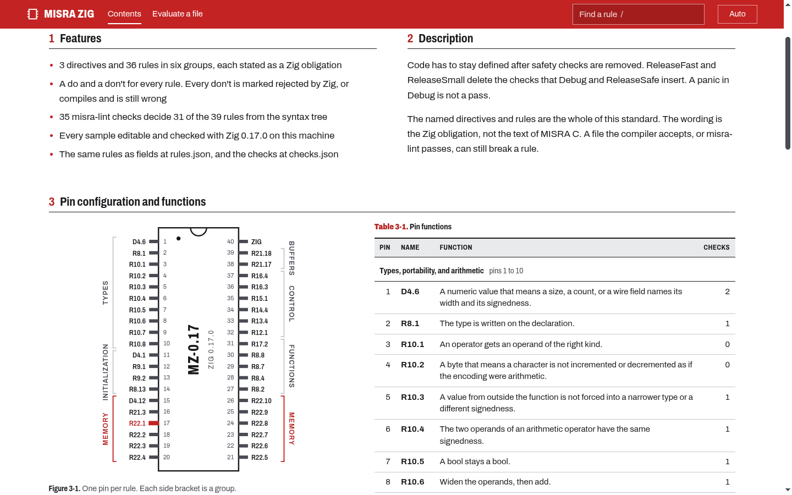

# MISRA Zig

A coding standard for Zig 0.17, inspired by MISRA C, for people who write Zig
that has to stay defined in ReleaseFast. Each rule comes with a do, a don't, and
the machine checks that decide it.

Debug and ReleaseSafe insert safety checks; ReleaseFast and ReleaseSmall delete
them, and the same `+`, index, or `@intCast` becomes illegal behavior. A panic
in Debug is not a pass. This standard names what has to hold without those
checks, shows each rule as compiling source, and ships `misra-lint`, a checker
built on the Zig parser that flags what a syntax tree can decide.



## Run it

Needs Zig 0.17.0 and Bun.

```bash
bun scripts/server.ts
```

Open `http://127.0.0.1:4173`. The handbook is set as a component datasheet: the
pin map on the front sheet has one pin per rule, and each rule sheet has its
description, the do and the don't as figures, and the checks that decide it.
Any sample can be edited and checked; "Evaluate a file" checks a whole file
with the compiler and misra-lint.

The handbook is also published at https://misra-zig.dev and https://misra-zig.com. The
published copy is read-only: Check runs only on a local server.

## Check your own code

```bash
zig run -ODebug tools/misra_lint.zig -- path/to/file.zig
```

On a file with a narrow sum and a leak on the error path:

```
demo.zig:4:14: violation[narrow_sum_widened] Rule 10.6: The operation runs at the narrow operand width and only the result is widened. Use std.math.add(Wide, a, b).
demo.zig:8:11: violation[try_before_release] Rule 22.1: A later try or return leaves before this resource has a defer or errdefer. (first)
```

`--json` prints fields, `--checks` lists the checks. Exit 1 means at least one
finding. See [docs/misra-lint.md](docs/misra-lint.md).

## Status

- 10 directives and 49 rules in seven groups, each with a do and a don't, numbered
  as in MISRA C:2025. The do functions are tested in `docs/examples/compliant.zig`
  at Debug and ReleaseSafe. [docs/misra-c-2025.md](docs/misra-c-2025.md) places
  all 223 C:2025 guidelines: adopted, rejected by the compiler, without a Zig
  counterpart, or left out and why.
- misra-lint: 67 checks naming 50 of the 59 rules. It flags 59 of the 71
  don't samples that compile; the other 12 need types, counts, threads, callers,
  the std source, a C header, or other files, which it does not have. `--root` adds a file-set
  check (Rule 2.1). The deprecated declarations and the `std.posix` wrappers
  that assume an errno come from lists generated out of the installed std.
  A clean run is not compliance.
- `GET /rules.json` and `GET /checks.json` serve the rules and checks as fields
  for tools and agents.
- Agent skills in `skills/`: write Zig under the standard, review Zig against
  it, change a rule, add a check. `bun scripts/review.ts FILE...` prints a
  review skeleton: findings by rule and a checklist of every rule.
- Not a publication of the MISRA Consortium. The rules are the ones named in
  `AGENTS.md`, not the whole of MISRA C.

## Docs

- [AGENTS.md](AGENTS.md): the standard, the checks, and how the repo is run
- [docs/misra-zig-handbook.md](docs/misra-zig-handbook.md): every rule with its do and don't
- [docs/misra-lint.md](docs/misra-lint.md): what the checker decides and what it cannot see
- [docs/misra-c-2025.md](docs/misra-c-2025.md): every MISRA C:2025 guideline and what it is in Zig
- [docs/ledger.md](docs/ledger.md): what changed, why, and how it was verified
- [docs/adr/](docs/adr/README.md): decisions, such as which practices from the Zig review guides became rules

## Tests

```bash
zig fmt --check .
zig test -lc -ODebug docs/examples/compliant.zig
zig test -lc -OReleaseSafe docs/examples/compliant.zig
zig test -ODebug tools/misra_lint.zig
zig test -OReleaseSafe tools/misra_lint.zig
bun test scripts/
bun scripts/check_samples.ts
```
